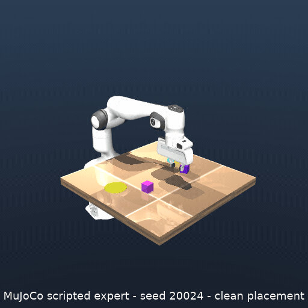

# sim2real - End-to-end sim-to-real data pipeline and VLA fine-tuning framework (MuJoCo + ROS 2 Jazzy)

`sim2real` generates synthetic Franka Panda tabletop demonstrations in MuJoCo under seeded domain
randomization, filters them with dimensionless-jerk, SPARC, path-length and limit-margin metrics,
writes versioned `curated_v1` episodes and LeRobot v3.0 datasets with statistics, splits and mixing,
fine-tunes SmolVLA with PEFT LoRA, and evaluates the policy in closed loop against a paired
scripted-expert baseline with failure-driven regeneration. A pure-Python orchestrator drives the
seven stages (`GENERATE -> FILTER -> BUILD -> TRAIN -> EVALUATE -> ANALYZE_FAILURES ->
TARGETED_GENERATE`) with deterministic stage ids, hard cycle/time/write/GPU bounds, approval gates,
resume, quarantine and a lineage manifest per cycle. Inputs are a seeded scene configuration and a
language instruction; the full CPU path needs only Python 3.12, NumPy, PyYAML, scipy, pyarrow and
the Open3D CPU wheel, while MuJoCo, ROS 2 Jazzy and a CUDA-capable GPU are optional tiers. Every
stage is deterministic, seed-scoped and hash-addressed, artifacts carry their provenance, and
unfinished or negative results are labelled as such. The pipeline is the deliverable: the trained
policy does **not** yet complete the task, with a paired expert at 24/30 on seeds 20000-20029, an
effective policy success rate of 0/30 (the recorded 1/30 is a success-definition false positive),
0/6 closed-loop success on the training seeds, and an unmet pre-registered overfit rule (first-step
arm L1 0.0333 rad against a 0.010 bar, gripper 0.00688 m against 0.005).



*The scripted expert on seed 21000, rendered from the recorded episode through a free
third-person camera (0.0 rad joint / 0.0 m object replay error). This is the scripted
expert, not the trained VLA policy; the policy result is reported honestly below.*

```text
scene + seed + instruction
        |
        v
[randomize + scripted expert] --> staging episodes (NPZ + sidecar + manifest)
        |
        v
[trajectory filter] --> curated_v1 (accepted) + rejection log
        |
        v
[LeRobot v3 build + mixer] --> dataset + stats + train/val split
        |
        v
[LoRA fine-tune on an external GPU] --> checkpoint + metadata
        |
        v
[closed-loop evaluation] --> records + paired expert baseline
        |
        v
[failure analysis] --> failure distribution
        |
        +--> [targeted generation, seeds 30000-30999] -- back to the expert
```

```text
cameras + /joint_states + /task_instruction
        |
        v
[vla_inference_node] --/vla/raw_action--> [safety_watchdog_node]
     (RAW and UNSAFE)                    validate, clip, EMA, retime,
                                          workspace, obstacle, limits
                                                    |
                                                    v
                    /joint_trajectory_controller/joint_trajectory
                                                    |
                                                    v
                    ros2_control (mock_components/GenericSystem)
```

When it works, a user gets a curated, versioned dataset with a rejection log; a checkpoint with
verified metadata and hashes; evaluation records with paired expert baselines, failure statistics
and a decision; and one lineage manifest per cycle that ties the seed, config hash, dataset hash,
checkpoint and evaluation run together.

## Table of Contents

- [What This Is](https://github.com/KuNaL8103/sim2real#what-this-is)
- [How It Works](https://github.com/KuNaL8103/sim2real#how-it-works)
  - [Core Logic](https://github.com/KuNaL8103/sim2real#core-logic)
  - [Safety Layers](https://github.com/KuNaL8103/sim2real#safety-layers)
- [Project Structure](https://github.com/KuNaL8103/sim2real#project-structure)
- [Prerequisites](https://github.com/KuNaL8103/sim2real#prerequisites)
  - [Language-level dependencies](https://github.com/KuNaL8103/sim2real#language-level-dependencies)
  - [System-level dependencies](https://github.com/KuNaL8103/sim2real#system-level-dependencies)
- [Setup](https://github.com/KuNaL8103/sim2real#setup)
- [Running](https://github.com/KuNaL8103/sim2real#running)
  - [Quick start without a GPU or robot](https://github.com/KuNaL8103/sim2real#quick-start-without-a-gpu-or-robot)
  - [Running the ROS 2 stack](https://github.com/KuNaL8103/sim2real#running-the-ros-2-stack)
  - [Running stages individually](https://github.com/KuNaL8103/sim2real#running-stages-individually)
- [Cleaning Up / Restarting](https://github.com/KuNaL8103/sim2real#cleaning-up--restarting)
- [Configuration](https://github.com/KuNaL8103/sim2real#configuration)
- [Interface Reference](https://github.com/KuNaL8103/sim2real#interface-reference)
- [Running Tests](https://github.com/KuNaL8103/sim2real#running-tests)
- [Validation Status](https://github.com/KuNaL8103/sim2real#validation-status)
- [Results and Measurements](https://github.com/KuNaL8103/sim2real#results-and-measurements)
- [Troubleshooting](https://github.com/KuNaL8103/sim2real#troubleshooting)
- [Known Limitations](https://github.com/KuNaL8103/sim2real#known-limitations)
- [Possible Extensions](https://github.com/KuNaL8103/sim2real#possible-extensions)
- [Documentation Index](https://github.com/KuNaL8103/sim2real#documentation-index)
- [License](https://github.com/KuNaL8103/sim2real#license)

## What This Is

This is a research-grade data and training pipeline, not a robot product. It exists to make every
step between a simulated demonstration and a closed-loop policy evaluation explicit, reproducible
and auditable on CPU hardware, with optional GPU and ROS 2 tiers. The repository contains the
algorithms (pure Python in `src/sim2real/`), thin ROS 2 adapters (`ros2_ws/src/`), validated YAML
configuration, command-line entry points, a large hardware-free test suite, and the measured
validation record.

Two backends are implemented: a deterministic kinematic `FakeBackend` that keeps the whole pipeline
testable with NumPy alone, and a headless MuJoCo Franka Panda tabletop with two 256x256 RGB-D
cameras. An Isaac Sim adapter exists as a guarded stub and **cannot be constructed on this
hardware**; no Isaac Sim behaviour is claimed.

The project has no physical robot. Mock hardware is not physical safety, a software e-stop is not a
safety-rated emergency stop, and simulator or unit-test success says nothing about a real Franka.

## How It Works

### Core Logic

The orchestrator is an explicit seven-stage state machine. Each stage declares its inputs, outputs,
environment, executor and config slice:

| Stage | Inputs | Outputs | Default executor |
| --- | --- | --- | --- |
| `GENERATE` | generation config, randomization/expert/sim configs | staging episodes (NPZ, sidecar, `manifest.jsonl`) | `local` |
| `FILTER` | staging, filtering config | `curated_v1` version, rejection log | `local` |
| `BUILD` | curated version, dataset config | validation summary, LeRobot dataset | `local` |
| `TRAIN` | dataset hash, training config | verified checkpoint and metadata | `external` |
| `EVALUATE` | checkpoint, evaluation config | `records.jsonl`, `manifest.json`, `pairs.json` | `local` |
| `ANALYZE_FAILURES` | evaluation records and pairs | hashed failure distribution | `local` |
| `TARGETED_GENERATE` | distribution artifact | targeted staging | `local` |

- **Seeds and the seed ledger.** Evaluation uses seeds 20000-20999 only; targeted
generation uses 30000-30999 only; the ledger reserves documented carve-outs (20900-20919 for the
safety expert check and 20950-20969 for fake-backend end-to-end tests). A stage that selects an
owned range is refused. `scripts/pipeline_orchestrator.py --ledger` prints the ledger.
- **Hash-addressed stage ids.** A stage id is
`sha256(stage, stage-config hash, inputs, schema)[:32]`. A completed stage is reused only when the
id matches and every recorded artifact still matches its SHA-256; otherwise the artifact and status
file move to `quarantine/<STAGE>-<timestamp>/` and the stage fails loudly.
- **Executors.** `local` runs the existing code in-process or in a bounded
subprocess; `external` is TRAIN-only, prints the exact remote bundle and command, waits for a
supplied checkpoint and verifies it; `fake` is a labelled deterministic test double whose checkpoint
records `verification: fake_executor`; `skip` records an explicit skip.
- **Approval gates.** `max_cycles`, `max_episodes_per_cycle`, `max_wall_time_s`,
`max_write_bytes` and `gpu_time_limit_s` are validated and enforced. Extra cycles require
`--approve-cycle` and a **new** verified checkpoint; GPU time, large writes and downloads have their
own flags. The CLI default is a dry run.
- **Bounded loops.** The failure flywheel is an append-only ledger with
`max_cycles`, `max_total_rollouts`, `max_rollouts_per_request`, `min_failures_to_trigger`,
`min_success_improvement`, `max_consecutive_no_improvement`, `cooldown_s` and a `STOP` file.
`REQUEST_RETRAIN` is reserved; the evaluation stage never trains.
- **Lineage.** Each cycle writes one atomic manifest with the config hash, git
commit and dirty flag, drawn seeds, source episode ids, dataset hash, checkpoint path and metadata
hash, evaluation run id, failure-distribution id, flywheel decision, per-stage statuses and wall
time. `--lineage` searches manifests by checkpoint path or metadata hash.

Failure analysis uses the feature vector `object_x, object_y, object_yaw, friction_sliding,
object_mass, light_intensity, color_temperature, camera_jitter_norm`. At least 30 failures fit a
Gaussian mixture selected by BIC; 10-29 use a Gaussian KDE; 1-9 use bounded neighbour perturbation;
zero failures is `NO_TARGETING`. The default failure definition is `policy_only` (the expert
succeeded and the policy failed), which requires paired evaluation data.

### Safety Layers

Raw policy output never reaches a controller. `/vla/raw_action` is consumed only by
`safety_watchdog_node`, which validates the final smoothed/retimed trajectory:

- joint names and order, finite values, point count, increasing times, future stamp;
- finger clipping to `[finger_min_m, finger_max_m]`;
- stale-chunk policy (`reject` by default, or opt-in `retime_if_continuous`);
- EMA smoothing initialised from the measured state;
- continuity from the measured state;
- TCP workspace bounds and an obstacle-distance gate;
- position, velocity, acceleration and jerk limits on the final trajectory.

The obstacle gate has two modes. `strict` is the default and uses a 2 cm grid Euclidean distance
transform. `masked` is an opt-in accuracy mode for simulation/mock only: exact surface distance, a
table-plane band, and an allowance around the commanded target object. Masked is validated only on
the kinematic fake backend with a synthetic map and a target parsed from the nominal scene; the
strict default remains in force for real hardware. `configs/safety/sim_mock.yaml` changes only
`obstacle_mode` and is used by the simulation/mock launches and CPU tests.

On `UNSAFE` the watchdog publishes one hold built from the measured state and does not latch.
`ESTOP` latches until `/estop_reset` succeeds after `estop_reset_hold_s` (2.0 s) of fresh, valid
joint and map inputs. `/safety/status` maps STARTING to DEGRADED, OK to NOMINAL, UNSAFE to SAFE_STOP
and ESTOP to ESTOP. `NaN` means unknown, never safe.

**Not covered:** whole-arm or swept-volume collision checking, self-collision, torque or effort
enforcement at the controller, dynamic stability, real network latency, or any functional-safety
certification. The mock stack models no dynamics, latency, torque, velocity enforcement or
collisions.

## Project Structure

```text
src/sim2real/                 pure Python, no rclpy: sim, randomization, expert,
                              filtering, data, mapping, dataset_builder,
                              training, evaluation, inference, safety, orchestrator
ros2_ws/src/                  thin ROS 2 adapters and interfaces
  sim2real_msgs               messages and services
  sim2real_sim                sim_node, expert collector, filter, eval nodes
  sim2real_perception         workspace mapper node
  sim2real_vla                VLA inference node
  sim2real_control            safety watchdog, mock ros2_control launch
configs/                      versioned YAML per subsystem
scripts/                      collection, filtering, datasets, training,
                              evaluation, policy server, orchestrator, verify
tests/                        hardware-free tests and analytic fixtures
docs/                         architecture, validation, deployment, recovery, ...
assets/mujoco/                pinned Menagerie XML; meshes are fetched
data/                         ignored: staging, curated, rejected, eval, flywheel
outputs/                      ignored: checkpoints and training artifacts
```

The pure-Python library is the source of truth for algorithms and constants. ROS 2 packages only
subscribe, publish, serve, convert messages and wire parameters.

## Prerequisites

### Language-level dependencies

- **Python 3.12 only** (`>=3.12,<3.13`); the code and CI target CPython 3.12.
- `.venv` - core library, lint, CPU tests and CI. It may use NumPy 2.x because ROS is
never imported there. `pyproject.toml` pins `scipy==1.16.3`, `pyarrow==21.0.0` and
`open3d-cpu==0.20.0`; the MuJoCo `sim` group installs `mujoco>=3.17.0`.
- `.venv-ros` - ROS adapter tests. It is created with `--system-site-packages`,
must see the system `rclpy` and the system NumPy **1.26.4**, and must not install its own NumPy. The
pinned scipy/pyarrow/open3d versions are installed with `--no-deps` because newer releases require
NumPy 2.x.
- `.venv-ml` - offline VLA fine-tuning: torch 2.11.0+cu126, LeRobot 0.6.1, PEFT,
accelerate, transformers, num2words. It is opt-in, never created by CI, and must not contain ROS or
simulator packages.

Why three environments: ROS Jazzy's Python modules are built against the system Python and system
NumPy, while the core and ML stacks want independent, newer ABI/versions. Mixing them silently
breaks message conversion or torch imports, so each environment has one job.

### System-level dependencies

- Ubuntu 24.04 (verified in WSL2 with kernel 6.18 on this machine).
- ROS 2 Jazzy at `/opt/ros/jazzy`, with `ros2_control`, `ros2_controllers`
(`joint_state_broadcaster`, `joint_trajectory_controller`, `controller_manager`) and `colcon`.
- `uv` for the Python environments; `git`; a C++ toolchain for colcon builds.
- MuJoCo assets: the pinned Menagerie Panda model is fetched by
`scripts/fetch_assets.sh` (about 33 MB; meshes are git-ignored).
- Optional: an NVIDIA GPU for training, and a remote GPU host for longer runs.
- WSL2 notes: `/dev/dxg` and the WSL CUDA libraries are used through the Windows
driver; no CUDA toolkit is required for `nvidia-smi`. Software OpenGL (`llvmpipe`) is the default
renderer. D3D12 renderer settings are opt-in benchmark-only and are never used by CI. Isaac Sim's
published minimums (16 GB VRAM, 32 GB RAM, RTX 4080) exceed this machine and no install is
authorized.

## Setup

```bash
# Core environment and dependencies (includes the 105 MB Open3D CPU wheel)
uv sync --group sim
./scripts/fetch_assets.sh                 # pinned Menagerie Panda meshes (~33 MB)

# Create .venv-ros (system ROS + system NumPy) and, optionally, .venv-ml
./scripts/setup_envs.sh
./scripts/setup_envs.sh --with-ml         # opt-in: torch/LeRobot; about 6.7 GB
```

`scripts/fetch_assets.sh` verifies the pinned commit and the Apache-2.0 license before copying. The
ML environment also downloads model/dataset caches on first use; the measured HF cache on this
machine was 2.9 GB.

## Running

### Quick start without a GPU or robot

These commands were run in this session (2026-11-18) on this checkout:

```bash
# Lint and the official ROS-free core baseline
env -u PYTHONPATH -u AMENT_PREFIX_PATH uv run ruff check .
env -u PYTHONPATH -u AMENT_PREFIX_PATH uv run ruff format --check .
env -u PYTHONPATH -u AMENT_PREFIX_PATH uv run pytest -ra

# Plan the pipeline without writing anything (default dry run)
uv run python scripts/pipeline_orchestrator.py --config configs/pipeline/default.yaml

# One fake-backend end-to-end cycle (real scripts; fake TRAIN only)
uv run python scripts/pipeline_orchestrator.py --config configs/pipeline/fake_e2e.yaml \
    --execute --root /tmp/sim2real/pipeline_e2e --cycles 1
```

Measured here: the dry run printed all seven stages and exited 0; the fake cycle completed
`cycle_0001` in **12.77 s wall** with a labelled fake checkpoint and a lineage manifest. The
recorded validation run for the same command was `wall=13.74s`.

```bash
# Headless MuJoCo physics smoke, one seeded episode, images off
uv run python scripts/collect_rollouts.py --backend mujoco --num 1 --seed 21000 \
    --out /tmp/sim2real/mujoco_smoke
```

Measured here: 1 episode generated in 0.199 s, outcome `success`, 44,324 bytes.

### Running the ROS 2 stack

Build and source once per shell:

```bash
source /opt/ros/jazzy/setup.bash
colcon build --symlink-install --parallel-workers 2 --base-paths ros2_ws/src
source ros2_ws/install/setup.bash
```

Launch files (all under `ros2_ws/src/*/launch/`):

- `sim2real_sim sim.launch.py` - `sim_node`; the only `/joint_states` owner while
it runs.
- `sim2real_perception mapper.launch.py` - RGB-D mapper and point cloud.
- `sim2real_vla vla_inference.launch.py` - inference node, `policy_backend:=fake`
by default.
- `sim2real_control safety.launch.py` - the safety watchdog against an external
source.
- `sim2real_control control_mock.launch.py` - mock ros2_control only.
- `sim2real_control pipeline_sim.launch.py` - sim + mapper + fake inference +
safety, **no controller**.
- `sim2real_control pipeline_mock_hw.launch.py` - ros2_control + safety + fake
inference + fake observations.

```bash
ros2 launch sim2real_control pipeline_sim.launch.py backend:=fake
ros2 launch sim2real_control pipeline_mock_hw.launch.py
```

**Single-owner rule:** `/joint_states` has exactly one publisher, either `sim_node` or the
ros2_control `joint_state_broadcaster`. The launch files refuse the combination; starting two
processes manually remains a configuration error.

There is **no live command subscription in `sim_node`**, so the ROS graph cannot close a control
loop through MuJoCo. Closed-loop evaluation uses the in-process runner. `/vla/raw_action` must never
be wired directly to the controller.

### Running stages individually

```bash
# Collect rollouts (fake or mujoco; images off unless --capture-images)
uv run python scripts/collect_rollouts.py --backend fake --num 20 --seed 0 \
    --perturbed-fraction 0.3 --out data/staging/dev_run

# Filter into a new curated version plus rejection log
uv run python scripts/filter_staging.py --staging data/staging/dev_run \
    --config configs/filtering/default.yaml --curated data/curated \
    --rejected data/rejected --dataset-name dev_curated

# Build a LeRobot v3 dataset (writer needs .venv-ml; --dry-run is core-only)
.venv-ml/bin/python scripts/build_lerobot_dataset.py --curated data/curated/dev_curated/v1.0.0 \
    --out data/lerobot --name dev --dry-run

# Closed-loop evaluation with a paired expert baseline
uv run python scripts/run_eval.py --backend fake --policy noisy_expert --num 60 \
    --seed 20000 --out data/eval/dev_eval

# Failure analysis and flywheel status
uv run python scripts/fit_failure_distribution.py --help
uv run python scripts/flywheel_status.py --help

# External GPU training: export a verified bundle, run it remotely, verify back
uv run python scripts/export_remote_bundle.py --help
./scripts/remote_train.sh --help
uv run python scripts/verify_remote_checkpoint.py --help
.venv-ml/bin/python scripts/train_vla.py --config configs/training/smolvla_lora.yaml --smoke --max-steps 2
```

## Cleaning Up / Restarting

The orchestrator can resume a cycle when the stage id and every artifact hash still match. A
mismatch quarantines the stage instead of silently reusing stale output. `docs/RECOVERY.md`
documents quarantine recovery, partial-output handling and the safe restart sequence.

Generated data lives under ignored directories:

- `data/staging/`, `data/curated/`, `data/rejected/` - rollouts and datasets;
- `data/eval/`, `data/flywheel/ledger.jsonl` - evaluation records and the
append-only flywheel ledger;
- `data/pipeline/`, `outputs/` - pipeline runs, checkpoints and logs;
- `build/`, `install/`, `log/` - colcon outputs.

Deleting those is safe for the code but destroys provenance; back up an interesting ledger,
checkpoint or manifest first. Never delete a curated version that a checkpoint or ledger row
references.

## Configuration

All configs are validated YAML with `schema_version: 1`. Unknown keys and invalid ranges fail
loudly.

- **Simulator** (`configs/sim/`): `scene.yaml` (world, table, cubes, zones, control
and physics rates), `panda.yaml` (MJCF path, joint/frame names, verified FER
position/velocity/acceleration limits, jerk/effort/torque-rate limits, home pose, TCP offset),
`cameras.yaml` (resolution, rate, fovy, extrinsics).
- **Randomization** (`configs/randomization/{none,light,default,heavy}.yaml`):
groups `object_pose`, `texture`, `lighting`, `camera`, `physics`, `distractors`, each with `enabled`
and bounded fields.
- **Expert** (`configs/expert/default.yaml`): `control_rate_hz`, `default_profile`,
`max_steps`, `ik`, `planner`, `motion`, `success`, `state_timeouts_s`, `physics_guard`, `staging`,
`instructions_file`, `perturbations_file`.
- **Filtering** (`configs/filtering/{default,mujoco}.yaml`): `validation`, `metrics`,
`hard_gates`, `soft_thresholds`, `weights`, `accept_score_threshold`.
- **Dataset** (`configs/dataset/default.yaml`): `dataset.name`, `output_root`,
`action_representation`, `decimation`, `max_episodes`, `val_fraction`, `split_seed`,
`allow_imageless`, `renderer`, `resolution`, `cameras`, `image_mode`, `quantile_method`,
`reservoir_size`, replay error tolerances; `bridge.*` for the fixture adapter. Mixtures live in
`configs/dataset/mixtures/`.
- **Training** (`configs/training/smolvla_lora.yaml`): `model`, `lora`, `data`,
`training`, `tracking`. `smolvla_lora_train_v1.yaml` is the full-data run config;
`openvla7b_lora.yaml` is an explicitly unvalidated, refusing config.
- **Evaluation** (`configs/evaluation/default.yaml`): `evaluation`,
`failure_analysis`, `flywheel`. `overfit_rule.yaml` is the pre-registered decision rule.
- **Inference** (`configs/inference/default.yaml`): `policy_backend`,
`checkpoint_path`, `server_python`, `server_script`, `startup_timeout_s` (180), `call_timeout_s`,
`policy_period_s`, `n_action_steps`, observation age/skew limits, `max_inference_rate_hz`,
`sample_seed`, `latency_compensation`, `max_restarts`, `restart_backoff_s`, `max_instruction_chars`,
`max_chunk_length`, `status_rate_hz`.
- **Safety** (`configs/safety/default.yaml`): `safety_margin_fraction`,
`workspace_bounds_m`, `safety_frame`, `min_obstacle_distance_m`, `obstacle_safety_radius_m`,
`obstacle_mode` (`strict` default), `table_surface_z_m`, `table_mask_band_m`,
`target_allowance_radius_m`, map validity/age/coverage settings, `max_chunk_age_s`,
`stale_chunk_policy`, `max_first_point_distance_rad`, `ema_alpha`, `watchdog_timeout_s`,
`estop_reset_hold_s`, finger bounds, `max_chunk_points`, `command_period_s`,
`command_time_convention`, `hold_duration_s`, `status_rate_hz`. `sim_mock.yaml` is identical except
`obstacle_mode: masked` and is limited to simulation/mock launches and CPU end-to-end tests.
- **Pipeline** (`configs/pipeline/{default,fake_e2e}.yaml`): `run_root`,
`max_cycles`, `max_episodes_per_cycle`, `max_wall_time_s`, `max_write_bytes`, `gpu_time_limit_s`,
plus `generation`, `filtering`, `build`, `training`, `evaluation`, `failure_analysis` and
`targeted_generate` stage slices.

## Interface Reference

Condensed from `docs/ARCHITECTURE.md`. QoS is explicit in `src/sim2real/sim/qos.py` and parsed by a
contract test.

| Name | Type | Producer | QoS | Note |
| --- | --- | --- | --- | --- |
| `/joint_states` | `sensor_msgs/JointState` | sim node **or** ros2_control | reliable, keep-last 10 | exactly one owner |
| `/tf` | `tf2_msgs/TFMessage` | sim node | reliable, keep-last 10 | 20 Hz, same stamp as joints |
| `/tf_static` | `tf2_msgs/TFMessage` | sim node / robot_state_publisher | reliable, transient-local, depth 1 | camera extrinsics |
| `/camera/{overhead,wrist}/color/image_raw` | `sensor_msgs/Image` | sim node | reliable, keep-last 5 | `rgb8` |
| `/camera/{overhead,wrist}/depth/image_raw` | `sensor_msgs/Image` | sim node | reliable, keep-last 5 | `32FC1`, metres |
| `/camera/{overhead,wrist}/camera_info` | `sensor_msgs/CameraInfo` | sim node | reliable, keep-last 5 | identical stamp |
| `/task_instruction` | `std_msgs/String` | operator / UI | reliable, keep-last 1 | latest wins |
| `/sim2real/staging_episode` | `sim2real_msgs/RolloutEpisode` | expert collector | reliable, transient-local, depth 10 | unfiltered |
| `/sim2real/filtered_episode` | `sim2real_msgs/RolloutEpisode` | filter | reliable, keep-last 50 | accepted only |
| `/sim2real/filter_metrics` | `sim2real_msgs/FilterMetrics` | filter | reliable, keep-last 50 | decision evidence |
| `/workspace/pointcloud` | `sensor_msgs/PointCloud2` | perception | reliable, keep-last 1 | frame `world` |
| `/workspace/tsdf_mesh` | `visualization_msgs/Marker` | perception | reliable, keep-last 1 | `TRIANGLE_LIST` |
| `/vla/raw_action` | `trajectory_msgs/JointTrajectory` | inference node | reliable, keep-last 10 | **RAW and UNSAFE** |
| `/vla/status` | `std_msgs/String` | inference node | reliable, keep-last 10 | JSON diagnostics |
| `/joint_trajectory_controller/joint_trajectory` | `trajectory_msgs/JointTrajectory` | safety watchdog **only** | reliable, keep-last 10 | zero stamp, `(j+1)*dt` |
| `/safety/status` | `sim2real_msgs/SafetyStatus` | safety watchdog | reliable, keep-last 10 | `NaN` means unknown |
| `/safety/diagnostics` | `std_msgs/String` | safety watchdog | reliable, keep-last 10 | additive JSON |
| `/estop` | `std_srvs/Trigger` | operator / UI | reliable service | latched |
| `/estop_reset` | `std_srvs/Trigger` | operator / UI | reliable service | fresh-input hold |
| `/sim2real/reset_env` | `sim2real_msgs/ResetEnv` | harness / operator | reliable service | applies a profile |
| `/sim2real/finalize_dataset` | `std_srvs/Trigger` | operator / UI | reliable service | new curated version |
| `/sim2real/generate_rollouts` | `sim2real_msgs/GenerateRollouts` | tooling / operator | reliable service | uniform or targeted |
| `/sim2real/run_eval` | `std_srvs/Trigger` | operator / UI | reliable service | in-process backend |
| `/sim2real/eval_summary` | `std_msgs/String` | evaluator | reliable, keep-last 10 | reporting only |
| `/workspace/reset_map` | `std_srvs/Trigger` | operator / orchestrator | reliable service | clears the TSDF |

Frames: `world` (root, z up), `panda_link0` (identity base), `panda_link1..7` (dynamic from backend
FK), `panda_hand`, `camera_overhead_optical_frame` (static from `world`),
`camera_wrist_optical_frame` (static from `panda_hand`). Optical frames follow REP-103/REP-105: x
right, y down, z forward. Frame IDs are relative, without a leading slash.

## Running Tests

Counts below are from this session (2026-11-18) unless marked recorded.

| Suite | Command | Result |
| --- | --- | --- |
| Core, ROS-free (official baseline) | `env -u PYTHONPATH -u AMENT_PREFIX_PATH uv run pytest -ra` | **667 passed / 0 failed / 32 skipped / 0 errors** (scikit-learn absent) |
| Lint | `uv run ruff check .` / `uv run ruff format --check .` | all checks passed; 294 files formatted |
| ROS adapters | `./scripts/build_and_test_ros.sh` (sourced Jazzy) | **699 passed / 0 failed / 5 skipped / 0 errors** |
| colcon | `colcon test-result --verbose` | **27 tests / 0 errors / 0 failures / 5 skipped** |
| ML | `scripts/run_ml_tests.sh` | **4 passed / 1 deselected** |
| CI parity | `./scripts/ci_parity.sh` | measured 2026-11-18 on the edited tree based on `2025e8c`: core **665 passed / 34 skipped**; ROS **27 / 0 / 0 / 13** |
| Clean clone | `./scripts/ci_parity.sh --clean-clone` | measured 2026-11-18 at `157123a` and `59c76b1`: **663 passed / 36 skipped**, rc 0 |

A skip is not a pass. Skips mean: ROS is not sourced in the core environment; the optional
`.venv-ml` or decoded dataset frames are absent; scikit-learn is not installed for the optional
cross-check; or `SIM2REAL_SKIP_RENDER=1` removes rendering tests in CI. `--clean-clone` mode is not
re-run in this session, so its count is marked recorded.

## Validation Status

Condensed from `docs/VALIDATION.md`; the source table decides what each level proves and does not
prove.

| Level | Scope | Status | Evidence |
| --- | --- | --- | --- |
| L1 | CPU unit/contract/lint/CI parity | **PASSED** | 667/0/32/0; ruff clean; parity 664/35; clean clone 663/36 |
| L2 | ROS 2 build and integration | **PASSED** | 5 packages; 699/0/5/0; colcon 27/0/0/5 |
| L3 | Headless MuJoCo + orchestrator | **PASSED (measured)** | 18.04 Hz joints, both cameras, 2.00 Hz cloud, fake cycle 13.74 s |
| L4 | Mock-hardware HIL | **PASSED (mock only)** | publisher count 1; 5.37 Hz forwarded; e-stop latched |
| L5 | Real-checkpoint inference smoke | **NOT RUN** | not approved; no command subscription in `sim_node` |
| L6 | Isaac Sim | **UNAVAILABLE** | 6 GB VRAM vs 16 GB published minimum |
| L7 | Physical robot | **NOT RUN** | no robot connected |

## Results and Measurements

All numbers are measured on the stated machine unless marked user-reported. Sources are linked so
the reader can inspect the raw tables.

| Result | Value | Source |
| --- | --- | --- |
| Paired expert success, 30 seeds 20000-20029 | **24/30 (0.800)**, Wilson [0.6269, 0.9050] | `docs/EVALUATION.md` |
| Recorded policy success, same seeds | **1/30**, a success-definition false positive; effective **0/30** | `docs/EVALUATION.md` |
| Policy success on expert-success seeds | **1/24** recorded; effective **0/24** | `docs/EVALUATION.md` |
| Success region | radius **0.060 m**; 1/40 train and 1/30 eval seeds start inside it | `docs/EVALUATION.md` |
| Oracle 10 Hz hold vs linear execution | hold **24/32**, linear **31/32**, 20 Hz ceiling **32/32** | `docs/EVALUATION.md` |
| Pre-registered overfit rule (remote 1,000 steps) | arm first-step L1 **0.0333 rad** (bar 0.010), gripper **0.00688 m** (bar 0.005), first-10 beats hold **1.0** (pass), clip delta **0.00170 m** (pass) | `docs/TRAINING.md` |
| Overfit closed loop on training seeds | **0/6**, all TIMEOUT | `docs/TRAINING.md` |
| Local overfit sanity run | 250 steps, final loss **0.49675**, **0/6** closed loop, GPU capped at **210 MHz** | `docs/TRAINING.md` |
| Real-checkpoint inference latency | 43 chunks / 42 published; median **1.88085 s**, p95 **3.61568 s**, max **5.90400 s**; ready **107.38 s** | `docs/VLA_INFERENCE.md` |
| Headless MuJoCo + mapper | joints **18.04 Hz**, overhead **1.863 Hz**, wrist **1.845 Hz**, cloud **1.999 Hz / 666 points** | `docs/VALIDATION.md` |
| Mock-hardware HIL | controller publisher count **1**, **5.37 Hz** forwarded, e-stop latched | `docs/VALIDATION.md` |
| Remote overfit run provenance | **user-reported**; no audited `as_used/` copy | `docs/REMOTE_TRAINING.md` |

Local timings are from a throttled GPU and are **not performance figures**. The policy-quality
conclusion is negative and is not softened anywhere in this repository.

## Troubleshooting

- **PowerShell vs WSL shell.** ROS and `uv` commands must run in the Ubuntu/WSL
terminal; Windows PowerShell cannot source `/opt/ros/jazzy/setup.bash` or see the Linux filesystem
paths used here. Use a Linux shell and the repository root.
- **NumPy ABI mismatch.** `.venv-ros` must keep the system NumPy 1.26.4. Installing
NumPy 2.x, or upgrading scipy/pyarrow past the pins, breaks message conversion or Parquet import.
The core `.venv` may use NumPy 2.x; never merge the environments.
- **GPU capped at low clocks.** The local RTX 4050 measured 210 MHz SM clock with
SW Power Cap/Thermal Slowdown under load. Training and latency numbers are marked throttled; fix
power/thermal limits before treating a run as a benchmark.
- **Policy-server startup timeout.** A 30 s per-call timeout is too short for the
first model load. `startup_timeout_s` defaults to 180 s; the measured ready time was 107.38 s
locally and 34.71 s remotely (user-reported).
- **Leftover ROS nodes and domain-id isolation.** Timing tests are sensitive to a busy
graph. Stop old nodes and use a dedicated `ROS_DOMAIN_ID` (the live checks used 81, 90
and 93); a different domain hides the graph, which is expected.
- **MuJoCo rendering under WSLg.** RViz and MuJoCo must not initialize GL in
parallel; the mapper uses `mapper.rviz` and the launches delay RViz by 8 s.

## Known Limitations

- **The trained policy does not complete the task.** It is under-trained; the
pre-registered overfit rule is unmet and the effective policy success is 0/30.
- **No ROS closed loop through MuJoCo.** `sim_node` has no command subscription;
evaluation uses the in-process runner. A bridge is a documented design decision.
- **Masked obstacle mode is narrowly validated.** It is measured only on the
kinematic fake backend with a synthetic map and uses the nominal cube pose for the target allowance.
`strict` remains the default.
- **Mock hardware and the software e-stop are not physical safety.** Mock hardware
models no dynamics, latency, torque, velocity enforcement or collisions.
- **Isaac Sim is unavailable on this hardware.** The adapter is a guarded stub; no
Isaac behaviour is claimed.
- **MoveIt 2 and OctoMap are not verified.** The MoveIt adapter raises
`PlannerUnavailable`.
- **Remote-run provenance is user-reported.** The remote run used hand-patched
requirements/launcher and no audited `as_used/` copy exists.
- **Latency runs 3 and 4 are NOT RUN** under the approved hard stop.
- **The dataset is small and skewed.** 40 training episodes, llvmpipe images,
accepted poses skew toward easier cube positions.
- **Video/MP4 encoding, real Bridge data and OctoMap are untested.**

## Possible Extensions

- Generate more expert data and train longer on a healthy GPU; the pipeline and
checkpoint verification already support resume and provenance.
- Add the ROS-to-simulator command bridge so the live chain can close through
MuJoCo; the smallest design is recorded in `docs/DEPLOYMENT.md`.
- Perform real-hardware bring-up with the strict profile, a real e-stop circuit and
the documented-only checklist.
- Add an Isaac Sim backend on a machine that meets the published 16 GB VRAM and
32 GB RAM minimums.
- Test a delta-action parameterization; the measured absolute-action first-chunk
error is the dominant failure and delta statistics are documented as a hypothesis.
- Build a multi-instruction dataset and retest conditioning; sensitivity is currently
below sampling noise.

## Documentation Index

- `docs/ARCHITECTURE.md` - packages, data flow, contracts/QoS, decision log.
- `docs/VALIDATION.md` - validation matrix, evidence, open items.
- `docs/DEPLOYMENT.md` - mock bring-up and documented-only physical procedure.
- `docs/RECOVERY.md` - resume, quarantine and recovery procedures.
- `docs/SAFETY.md` - safety design, limits, measured obstacle results.
- `docs/EVALUATION.md` - timing contract, failure analysis, flywheel, measurements.
- `docs/TRAINING.md` - fine-tuning decisions, runs, overfit rule.
- `docs/REMOTE_TRAINING.md` - bundle, remote runbook and provenance.
- `docs/DATASETS.md` - staging, curated layout, LeRobot export.
- `docs/FILTER_METRICS.md` - metric formulas and threshold provenance.
- `docs/IMAGE_REPLAY.md` - deterministic replay rendering.
- `docs/VLA_INFERENCE.md` - inference node, timing, validation.
- `docs/ISAAC_SIM.md` - Isaac Sim requirements and guarded adapter.
- `docs/MANUAL_CHECKS.md` - pending manual verification steps.
- `docs/STATUS.md` - current status, counts and open items.

## License

Apache-2.0. See [`LICENSE`](LICENSE).
